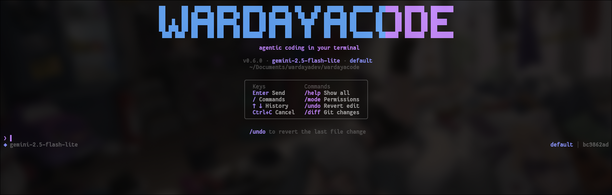

# WardayaCode

**AI-powered coding agent for your terminal.** Multi-provider, permission-aware, and built for real development workflows.

[](package.json)
[](https://www.npmjs.com/package/wardayacode)
[](https://github.com/fawwazmw/wardayacode/actions/workflows/ci.yml)
[](LICENSE)
[](https://github.com/fawwazmw/wardayacode)

<p align="center">
  
</p>

---

## Install

```bash
npm install -g wardayacode
```

Then navigate to your project and run:

```bash
wardayacode
# or
wdc
```

Requires **Node.js 20+**.

---

## Quick Start

```bash
# Set your API key (choose one)
export ANTHROPIC_API_KEY=sk-ant-...
# or
export OPENAI_API_KEY=sk-...
# or
export GOOGLE_GENERATIVE_AI_API_KEY=AIza...

# Start a session
cd my-project
wardayacode
```

Type any task in natural language. The agent reads your files, makes edits, runs commands, and explains every step.

---

## Features

- **Multi-provider** — Anthropic Claude, OpenAI GPT, Google Gemini. Switch at runtime with `/model`.
- **Permission controls** — Four modes (`default`, `plan`, `acceptEdits`, `auto`) gate every tool call.
- **44 slash commands** — Full command catalog with tabbed help dialog. Type `/help` to browse.
- **Session management** — Auto-saved conversations, resume across restarts, export to markdown.
- **Undo & checkpoint** — Revert file edits, git stashing, diff viewing.
- **Extensible** — MCP server support, skills, and hooks (see [Extensibility](#extensibility)).
- **Privacy-first** — Your code talks through your own API keys. Nothing leaves your machine without your consent.
- **Terminal-native UI** — React + Ink, streaming output, keyboard-driven workflow.

---

## Usage

```bash
# Interactive TUI (default)
wardayacode

# Choose provider and model
wardayacode --model gpt-4o --provider openai
wardayacode --model gemini-2.0-flash --provider google
wardayacode --model claude-sonnet-4-20250514 --provider anthropic

# Permission mode
wardayacode --mode auto          # auto-approve everything
wardayacode --mode plan          # read-only, no writes

# Resume a session
wardayacode --resume <sessionId>

# Max API retries (default: 3, exponential backoff)
wardayacode --max-retries 5
```

---

## Permission Modes

| Mode          | File reads | File writes | Bash / Git | Use case      |
| ------------- | ---------- | ----------- | ---------- | ------------- |
| `default`     | ✅ auto    | ❓ prompt   | ❓ prompt  | Daily use     |
| `plan`        | ✅ auto    | ❌ blocked  | ❌ blocked | Review-only   |
| `acceptEdits` | ✅ auto    | ✅ auto     | ❓ prompt  | Trusted edits |
| `auto`        | ✅ auto    | ✅ auto     | ✅ auto    | Scripting     |

Switch mid-session with `/permissions` or choose "Always allow" when prompted.

---

## Slash Commands

Type `/` in the TUI to open the command palette, or browse the full catalog with `/help`.

| Command       | Description                        |
| ------------- | ---------------------------------- |
| `/status`     | Version, model, mode, session info |
| `/cost`       | Session cost & duration estimate   |
| `/context`    | Context usage visualization        |
| `/theme`      | Switch dark / light mode           |
| `/export`     | Export conversation to markdown    |
| `/rename`     | Name the current session           |
| `/resume`     | Resume a previous session          |
| `/init`       | Create WARDAYA.md for your project |
| `/plan`       | Enter plan mode (read-only)        |
| `/stats`      | Usage statistics                   |
| `/model`      | Show or switch the model           |
| `/effort`     | Set effort level (low/medium/high) |
| `/branch`     | Create a git branch                |
| `/diff`       | View uncommitted changes           |
| `/undo`       | Revert last file edit              |
| `/checkpoint` | Create a git stash checkpoint      |
| `/rollback`   | Restore last checkpoint            |
| `/review`     | List open pull requests            |
| `/copy`       | Copy last response to clipboard    |
| `/mcp`        | Manage MCP servers                 |
| `/skills`     | List loaded skills                 |
| `/hooks`      | Show hook status (`/hooks trust`)  |
| `/permissions`| Show active permission rules       |
| `/doctor`     | Installation diagnostics           |
| `/feedback`   | Submit feedback                    |
| `/config`     | Show configuration                 |
| `/clear`      | Reset conversation                 |
| `/compact`    | Manually compact context           |
| `/help`       | Full command catalog               |
| `/exit`       | Exit                               |

Run `/help` inside WardayaCode for the complete list with descriptions.

---

## Tools

The agent uses these tools to interact with your codebase:

| Tool         | What it does                                      |
| ------------ | ------------------------------------------------- |
| `read_file`  | Read a file with optional line range              |
| `write_file` | Create or overwrite a file                        |
| `edit_file`  | Surgical string-replacement edits                 |
| `bash`       | Run shell commands                                |
| `git`        | Run git commands (status, log, diff, add, commit) |
| `glob`       | Find files by pattern                             |
| `grep`       | Search file contents with regex                   |
| `list_files` | List a directory                                  |

Dangerous operations (force push, `rm -rf`, `dd`, etc.) are permanently blocked.

---

## Extensibility

### MCP servers

WardayaCode can connect to local [Model Context Protocol](https://modelcontextprotocol.io) servers and expose their tools to the agent. Configure servers in `.mcp.json` at the project root, and/or one-per-file in `.wardayacode/mcp/*.json` (`.mcp.json` wins on name collisions):

```json
{
  "mcpServers": {
    "filesystem": {
      "command": "npx",
      "args": ["-y", "@modelcontextprotocol/server-filesystem", "."]
    }
  }
}
```

In the TUI:

```
/mcp                  # status of configured servers
/mcp connect <name>   # connect — you approve the exact command first
/mcp disconnect <name>
```

MCP tools are named `mcp__<server>__<tool>` and are **always permission-gated** — never auto-approved, even in `auto` mode.

### Skills

Skills are Markdown instructions the agent applies when relevant. Drop `.md` files in `.wardayacode/skills/` (project) or `~/.config/wardayacode/skills/` (user). The filename is the skill name, the first `# heading` is its description, and an optional `triggers:` line aids selection:

```md
# Release Checklist

- Run `npm run type-check` and `npm run test:run`
- Update the changelog
- Tag `vX.Y.Z`
```

Loaded skills are injected into the agent's system prompt (size-capped). List them with `/skills`.

### Hooks

Hooks run your own scripts on agent events. Add `<event>.sh` (or `.js`) to `.wardayacode/hooks/` (project) or `~/.config/wardayacode/hooks/` (user).

Events: `preToolUse`, `postToolUse`, `sessionStart`, `sessionEnd`, `userPromptSubmit`, `stop`.

The hook receives the event context as JSON on **stdin**. For `preToolUse`:

- exit `0` → proceed; stdout may be JSON `{"proceed":true,"modifiedInput":{...}}` to rewrite the tool args
- exit `2` → block; stderr (or JSON `{"proceed":false,"reason":"..."}`) becomes the reason

```bash
#!/usr/bin/env bash
# .wardayacode/hooks/preToolUse.sh — refuse writes to .env
ctx=$(cat)
path=$(printf '%s' "$ctx" | node -e 'let s="";process.stdin.on("data",d=>s+=d).on("end",()=>console.log(JSON.parse(s).toolInput?.filePath??""))')
case "$path" in */.env) echo "refusing to touch .env" >&2; exit 2;; esac
exit 0
```

**Trust:** user-level hooks always run. Project hooks do **not** run until you trust the project, because they can arrive with a cloned repository:

```
/hooks          # show discovered hooks and their trust state
/hooks trust    # trust this project's hooks (stored in ~/.config/wardayacode/hooks-trust.json)
```

Hooks time out after 10 seconds; a crash or timeout is non-blocking.

---

## Configuration

Config **priority** (highest wins): CLI flags → project `.wardayacode.json` → user config → defaults.

Create `.wardayacode.json` in your project root:

```json
{
  "provider": "anthropic",
  "model": "claude-sonnet-4-20250514",
  "permissionMode": "default",
  "maxTokens": 8192,
  "temperature": 0,
  "maxRetries": 3,
  "theme": "dark"
}
```

API keys can also live in config, though environment variables are preferred:

```json
{
  "apiKeys": {
    "anthropic": "sk-ant-...",
    "openai": "sk-...",
    "google": "AIza..."
  }
}
```

---

## Sessions

Conversations are auto-saved as JSONL files in `.wardayacode/` in your project directory.

```bash
wardayacode sessions list          # list sessions
wardayacode sessions delete <id>   # delete a session
wardayacode --resume <id>          # resume a session
```

---

## Development

```bash
git clone https://github.com/fawwazmw/wardayacode.git
cd wardayacode
npm install

npm run dev            # run from source (no build)
npm run build          # bundle to dist/
npm run type-check     # TypeScript strict check
npm run lint           # ESLint
npm test               # Vitest watch mode
npm run test:run       # single CI run
npm run test:coverage  # with coverage report
```

### Project Structure

```
src/
├── agent/            — Agent loop (ReAct + Vercel AI SDK)
├── cli.ts            — CLI entry point (Commander.js)
├── config/           — Config cascade (defaults → user → project → CLI)
├── context/          — Context management & auto-compaction
├── extensibility/    — Hook system & skill system
├── permissions/      — Permission gating for all tool calls
├── providers/        — LLM provider adapters
├── session/          — Session persistence (append-only JSONL)
├── tools/            — Tool definitions & execution
├── types.ts          — Core type definitions
├── ui/               — React/Ink terminal UI components
└── utils/            — Logger, retry, self-update, formatting
```

### Branch Strategy

- `main` — Production, matches latest npm release
- `develop` — Integration branch, default for PRs
- `feature/*` — New features
- `fix/*` — Bug fixes
- `release/*` — Release preparation

---

## Keyboard Shortcuts

| Key           | Action                          |
| ------------- | ------------------------------- |
| `/`           | Open command palette            |
| `Tab`         | Auto-complete command           |
| `Enter`       | Submit prompt                   |
| `Shift+Enter` | Insert newline (multi-line)     |
| `Esc`         | Clear input / interrupt agent   |
| `Ctrl+C`      | Interrupt / clear input / exit  |
| `Ctrl+D`      | Exit                            |
| `Ctrl+O`      | Toggle verbose tool output      |
| `↑` / `↓`     | Prompt history                  |
| `Ctrl+A/E`    | Jump to line start / end        |
| `Ctrl+U/K/W`  | Delete to start / end / word    |

> `!`, `@`, `&` prefix modes and the `Alt`/`Ctrl+T` shortcuts shown in some
> agent CLIs are **not** implemented here.

---

## License

MIT — [Fawwaz Mufid W](https://github.com/fawwazmw)
